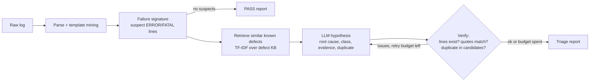

# LogTriage Agent

LLM-assisted **log analysis and defect triage** for cellular/modem-style test runs.
Given a failed test log, the agent finds the root-cause line, classifies the fault, cites evidence,
and checks whether the failure duplicates a known defect, with deterministic verification so the
LLM cannot invent evidence.

Built as a student project on the theme of *AI/ML automation for cellular software testing*:
LLM APIs, a RAG-style defect lookup, an agentic workflow (LangGraph), an MCP tool server,
prompt-version evaluation, REST API, dashboard, tests and CI.

> **Data note:** real modem logs are proprietary, so all logs here are **synthetic** (see `generator.py`).
> They are designed to contain realistic difficulties (cascading failures, benign "ERROR" lines,
> paraphrased wording, duplicates vs novel failures) with exact ground-truth labels.
> Results on synthetic data show the pipeline works, they are **not** a claim about real-world accuracy.

## How it works



1. **Parse + template mining** (`parser.py`): variable fields (numbers, IDs, IPs) are masked so the same
   event is recognised across runs. Cause codes like `#11` and timers like `T3410` are kept.
2. **Failure signature** (`signature.py`): learns from *passing* runs which ERROR templates are routine
   (e.g. "NVRAM read retry succeeded"); the rest are suspects. The **earliest** suspect is the root-cause
   candidate, because failures cascade (sync loss -> radio link failure -> registration timeout).
3. **Retrieval** (`kb.py`): the signature is matched against a knowledge base of known defects (TF-IDF).
4. **LLM hypothesis** (`llm.py`, `prompts.py`): returns structured JSON. Two prompt versions (`v1`, `v2`)
   can be compared. Backends: `offline` (keyword baseline), `anthropic`, `openai` (any OpenAI-compatible
   server, including free local models via Ollama).
5. **Verification** (`agent.py`): every cited line must exist and the quoted text must be in that line;
   `duplicate_of` must come from the retrieved candidates. On failure the agent retries once with feedback,
   then falls back to safe deterministic values and flags the run for human review.

## Results (offline baseline, 150 test runs, synthetic)

| backend | data | fault-class acc. | macro F1 | root-line acc. | duplicate F1 | citation validity |
|---|---|---|---|---|---|---|
| offline keyword rules | easy | 1.00 | 1.00 | 1.00 | 0.92 | 1.00 |
| offline keyword rules | hard (paraphrased) | 0.80 | 0.74 | 0.80 | 0.82 | 1.00 |

The keyword baseline is perfect on the easy data (it was written against that wording) and drops 20 points
when firmware wording changes. **That gap is the room an LLM should fill.** Add your own rows by running
`python -m logtriage.evaluate --backend anthropic --prompt v1 v2 --hard --n 60` (see below) and paste the table
into this README. Protocol: a dev split (seed 1) is used only to fit routine-error statistics and tune the
duplicate threshold; reported numbers come from a separate test split (seed 2).

## Quickstart

```bash
python -m venv .venv && source .venv/bin/activate      # Windows: .venv\Scripts\activate
pip install -r requirements.txt
export PYTHONPATH=src                                   # Windows PowerShell: $env:PYTHONPATH="src"
pytest -q                                               # 27 tests, no API key needed
python -m logtriage.evaluate --n 150                    # offline baseline, easy + hard
streamlit run app/streamlit_app.py                      # dashboard
uvicorn logtriage.api:app --reload                      # REST API, docs at /docs
python -m logtriage.mcp_server                          # MCP server (stdio)
```

Try the CLI on a sample: `data/samples/` holds four logs plus `ground_truth.json`.

### Use a real LLM

```bash
# Claude
export ANTHROPIC_API_KEY=...        # optionally LOGTRIAGE_MODEL=<model id>
python -m logtriage.evaluate --n 60 --backend anthropic --prompt v1 v2 --hard

# Free local model with Ollama (ollama pull llama3.1)
export LOGTRIAGE_BASE_URL=http://localhost:11434/v1 LOGTRIAGE_MODEL=llama3.1
python -m logtriage.evaluate --n 60 --backend openai --prompt v1 v2 --hard
```

### MCP (Claude Desktop or any MCP client)

```json
{ "mcpServers": { "logtriage": {
    "command": "python", "args": ["-m", "logtriage.mcp_server"],
    "env": { "PYTHONPATH": "/absolute/path/to/logtriage-agent/src" } } } }
```

Tools: `triage_log`, `search_defects`, `list_error_events`, `get_log_context`.

### Docker

```bash
docker build -t logtriage . && docker run -p 8000:8000 logtriage
# then open http://localhost:8000/docs and try POST /triage with a log from data/samples/
```

## Project layout

```
src/logtriage/
  generator.py   synthetic logs + ground truth        defects.py   known-defect KB (ticket-like records)
  parser.py      parsing, template masking            signature.py suspect events, routine-error stats
  kb.py          TF-IDF defect retrieval              prompts.py   prompt v1 / v2 and JSON schema
  llm.py         offline | anthropic | openai-compat  agent.py     LangGraph workflow + verification
  tools.py       shared tool functions                mcp_server.py MCP tools
  api.py         FastAPI                              evaluate.py  metrics and prompt/backend comparison
app/streamlit_app.py   dashboard          tests/   27 tests (agent logic uses a scripted fake LLM)
```

## Limitations and next steps

- Synthetic data, 8 fault classes, single-log analysis. Real logs are messier and far larger.
- Retrieval is lexical (TF-IDF). Next: sentence embeddings, hybrid BM25 + embeddings, reranking.
- The offline baseline is a keyword matcher, not a model. Real LLM results must be measured by running the evaluation.
- Not covered: multi-log correlation, log chunking for very large files, fine-tuning a small classifier,
  a labelled set of real (public) logs such as LogHub for external validation.
